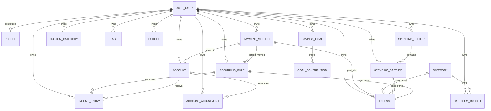

# Nola data model

This document maps the records Nola keeps in the browser and the rows it synchronizes to Supabase. The SQL migrations under `supabase/migrations/` define the hosted schema; `src/lib/types.ts` defines the app-facing records.

## Storage layers

1. **Auth identity** — Supabase Auth owns the signed-in user, email, provider identity, and session. `public.profiles` stores Nola preferences keyed by the Auth user ID.
2. **Local app state** — `PersistedAppData` in `src/lib/types.ts` is cached per user in browser `localStorage` through `src/lib/browser-storage.ts`. This is ordinary browser storage, not encryption at rest. Writes are queued locally when cloud sync is enabled or offline.
3. **Cloud records** — owned financial and note records live in `public` tables with RLS. `src/lib/offline-sync.ts` retries queued upserts/deletes, sends parents before dependent rows, and caps each flush at 25 operations.
4. **Derived and external data** — balances and insights are calculated from saved rows; recurring rules generate ordinary income/expense rows. If the user enables AI parsing and submits a note, the server sends its source text to Google Gemini. Web Push endpoints and reminder preferences are stored separately from spending records.

The demo identity (`demo-user`) and `createDemoData()` are browser-only fixtures. Demo state is not a Supabase Auth user and the demo disables AI parsing.

## Domain map

`CATEGORY` includes both shared global categories (`user_id IS NULL`) and user-owned custom categories. Tags are stored as UUID arrays on expenses, captures, and recurring rules; RLS validates every referenced tag belongs to the same user.

## Records in the local snapshot

`PersistedAppData` contains the nullable profile; categories; payment methods; tags; expenses; spending captures and folders; income entries; overall and category budgets; recurring rules; accounts and adjustments; savings goals and contributions; and the sync outbox. Auth identity and app preferences such as theme, language, consent, and notification enablement use separate storage keys.

The local snapshot is user-scoped when read and written. The app merges local and remote rows by ID and `updated_at`; the database additionally compares `client_updated_at` to reject stale client overwrites. IDs are generated client-side for offline creation and sent with upserts so retries remain idempotent.

`UserIdentity` is derived from the current Auth user (ID, email, provider, display name, avatar URL, and Auth creation time); the demo identity stays local. Consent, cookie consent, language, theme, and notification opt-in are separate browser preferences rather than finance tables. Auth profile metadata is display data only and is not an authorization source.

## Spending notes and expenses

- A `spending_capture` retains the original note text, folder/tags, capture time, parser status/revisions, and parsed JSON result.
- The home create-note action reopens the newest active capture for the user's current local calendar day; editing/appending changes that same capture instead of creating another one for the day.
- Each accepted parsed item is also persisted as an `expenses` row with `capture_id`. `parsed_items` is a parse snapshot, not a second authoritative ledger.
- An expense can exist without a capture (`capture_id IS NULL`) for manual entry. Deleting a note soft-deletes the note and its linked expenses; deleting one linked expense does not erase the source note.
- `quantity` describes item count independently of `amount`. For example, “7000 somsa 4x” can store UZS 7,000 and quantity 4.

## Money, accounts, and recurring activity

- Every monetary row carries its own ISO-style three-letter currency code. Nola does not sum across currencies without conversion.
- Accounts are linked to payment methods using the same UUID. Account balances are derived from starting balance, income, expenses, and account adjustments; the balance is not a stored column.
- Overall budgets are month/currency records. Category budgets add category and weekly/monthly cadence.
- Recurring rules are templates. When due, the client creates normal expense or income rows linked back through `recurring_rule_id` and advances the rule's `next_run_date`.
- Savings contributions are immutable as to goal, owner, currency, amount, kind, and occurrence date. Corrections are represented by another contribution, typically a withdrawal.

## Deletion and timestamps

Financial rows generally use `deleted_at` for recoverable deletion. Categories, payment methods, goals, and recurring rules also use `archived_at` where the record remains historical but is no longer offered for new activity. Foreign-key cascades are used for account deletion and dependent goal/account records; `ON DELETE SET NULL` preserves expenses when a note or recurring rule is removed where specified by the schema.

`created_at` and `updated_at` are server timestamps. Client-synced entities also have `client_updated_at`; the `keep_latest_client_write()` trigger ignores an update older than the row's current client timestamp and sets `updated_at` for an accepted update.

## Related source

- Types and local snapshot: `src/lib/types.ts`
- Local persistence and account scoping: `src/lib/app-store.tsx`, `src/lib/browser-storage.ts`
- Sync order/retries: `src/lib/offline-sync.ts`
- Demo-only sample records: `src/lib/demo-data.ts`
- Cloud schema and policy history: `supabase/migrations/`
